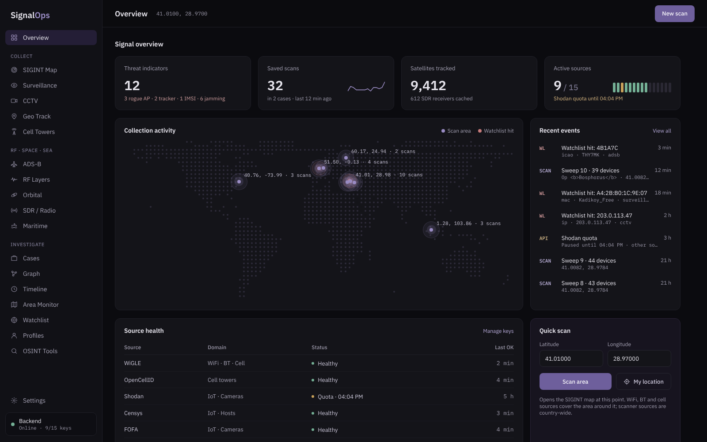
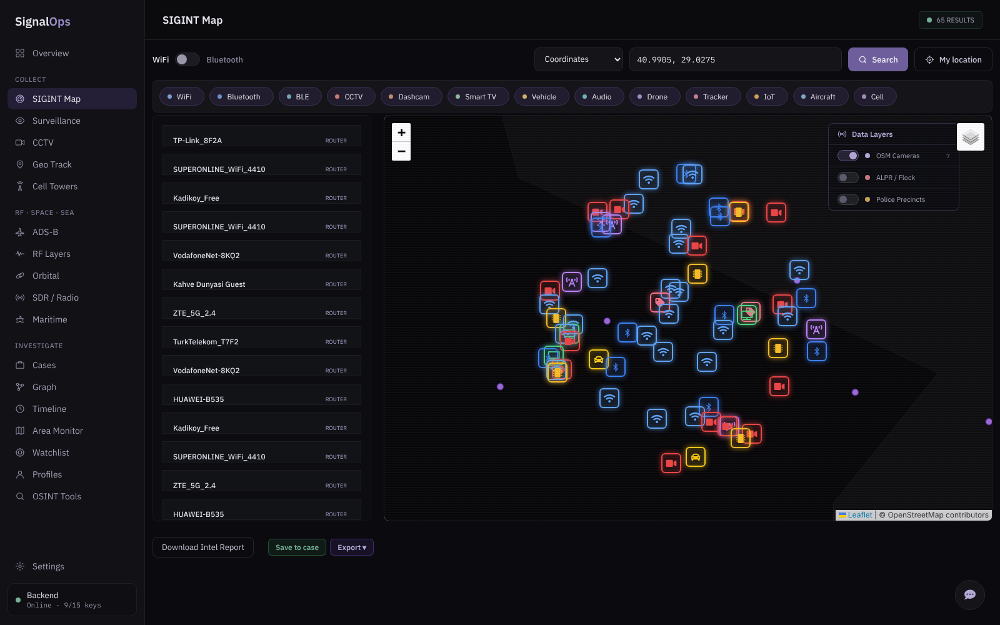
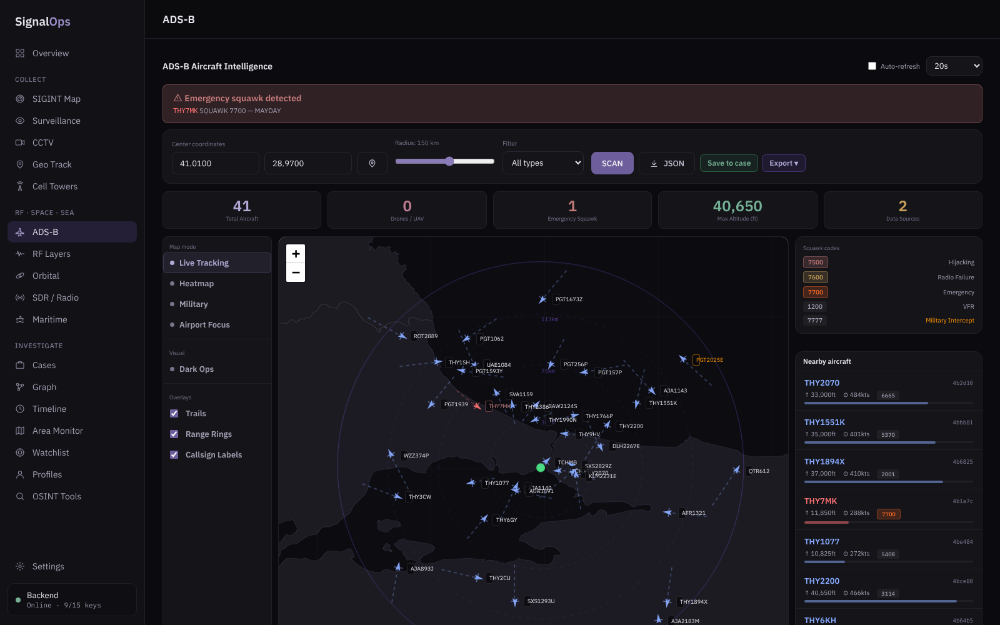
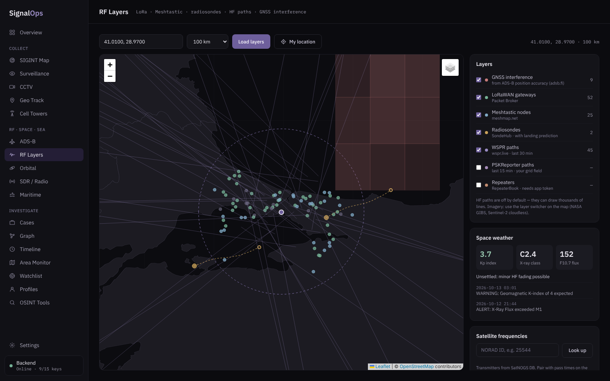

# SignalOps

SignalOps puts what is transmitting around a location on one map: Wi-Fi and Bluetooth devices, cell towers, exposed and public cameras, aircraft, satellites, ships and RF networks. It runs on your own machine. There is no account and no cloud backend.



## What it finds

- **Wireless and cellular:** Wi-Fi access points, Bluetooth and BLE devices and cell towers around a point (WiGLE, OpenCellID), with rogue AP, tracker and IMSI-catcher heuristics.
- **Cameras:**
  - Internet-exposed IP cameras from Shodan, FOFA, Censys, Netlas and ZoomEye.
  - 21 official public camera networks, including TfL, NYC DOT, Caltrans, Digitraffic, DGT, Vegagerðin, NSW, QLDTraffic, the 511 systems, NPS and USGS.
- **Air:** live ADS-B traffic with emergency squawks, drone detection, routes and registrations.
- **RF:** GNSS jamming zones derived from ADS-B, LoRaWAN gateways, Meshtastic nodes, radiosondes with landing predictions, WSPR / PSKReporter HF paths, KiwiSDR receivers and APRS stations.
- **Space and sea:** satellite passes with their downlink frequencies (SatNOGS), space weather (NOAA), and AIS vessels.
- **Investigation:** cases, change detection between scans, a correlation graph, a timeline replay, area monitoring with webhook alerts, a watchlist, and PDF / KML / GeoJSON / CSV export.







<sub>Screenshots use mock data and documentation-range IPs.</sub>

## Install

```bash
pipx install signalops-sigint     # or: pip install signalops-sigint (inside a venv)
signalops
```

On Debian / Ubuntu / Kali, plain `pip install` outside a virtualenv is blocked (PEP 668), so use `pipx` (`sudo apt install pipx`).

The app opens at **http://localhost:8080**. Add whichever API keys you have under **Settings**. Every source is optional, and the free ones (OSM, adsb.fi, CelesTrak, SondeHub, Meshtastic, NOAA, public cameras) work without a key.

To run from source instead:

```bash
git clone https://github.com/emrekybs/signalops.git && cd signalops
./start.sh            # Windows: start.bat · Docker: docker compose up -d
```

- **State:** with pip, keys, the database and data live in `~/.signalops`; from source, they stay in the repo folder.
- **Optional datasets:** the camera, ALPR and precinct datasets go in `data/`.
- **Options:** `signalops --port 9090 --home /path`, plus optional Tor or a SOCKS proxy in Settings.
- **Turkish install guide:** [KURULUM.md](KURULUM.md).

## Responsible use

SignalOps is for lawful, authorized research and education. Finding a device does not give you permission to access it. Follow local law and each provider's terms.

## License

[MIT](LICENSE) © 2026 Emre Kybs
